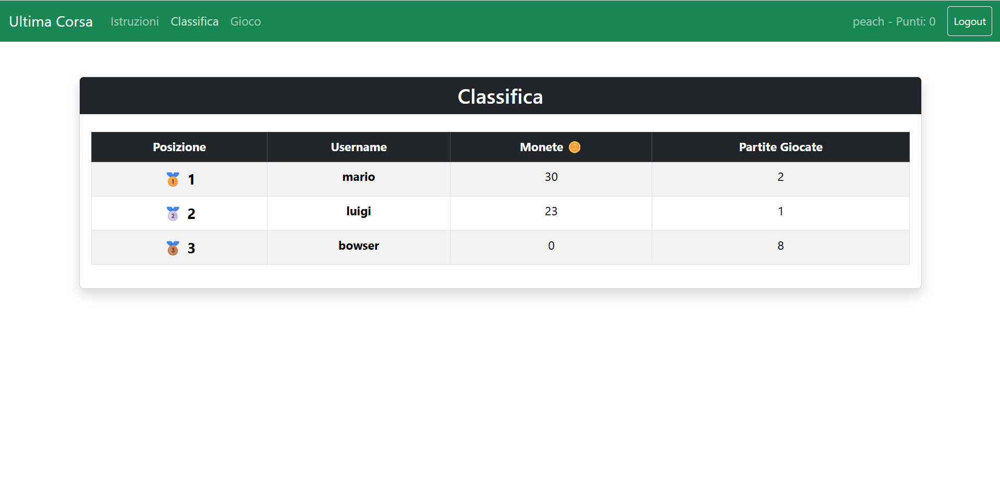
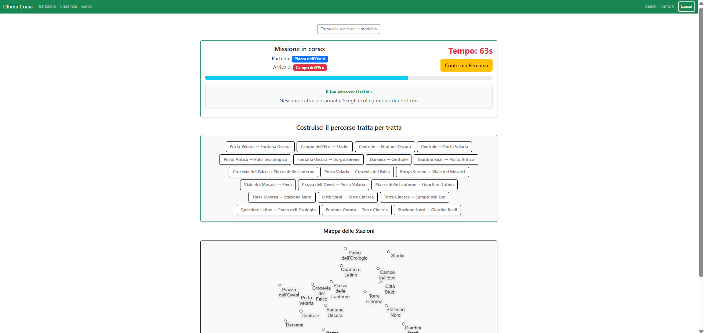

# Exam #1: "Ultima Corsa"
## Student: s354790 VIANELLO SAMUELE 

## React Client Application Routes

* Route `/`: Homepage dell'applicazione, mostra il titolo e descrizione del gioco.
* Route `/login`: Pagina contenente il form per l'autenticazione dell'utente. Se l'utente è già loggato, viene reindirizzato alla home.
* Route `/istruzioni`: Pagina statica accessibile a tutti che spiega le regole del gioco. Pulsante che invita al login per giocare o che sposta verso la partita.
* Route `/gioco`: (Rotta protetta) Hub del gioco che gestisce la scelta tra due modalità di gioco: modalità normale (Gioco.jsx) e modalità facile (GiocoFacile.jsx), con possibilità di navigazione nel menù.
* Route `/classifica`: (Rotta protetta) Mostra la tabella con i punteggi migliori (monete) di tutti gli utenti registrati, ordinati in ordine decrescente.
* Route `*`: Catch-all che reindirizza le URL inesistenti alla home `/`.

## API Server

### 0. Taella riassuntiva: 

| Metodo | Endpoint | Autenticazione | Descrizione |
| --- | --- | --- | --- |
| **POST** | `/api/auth/login` | No | Autentica l'utente tramite credenziali e avvia la sessione protetta. |
| **DELETE** | `/api/auth/logout` | Sì | Distrugge la sessione corrente ed effettua la pulizia del cookie. |
| **GET** | `/api/auth/current` | No | Verifica la sessione attiva e restituisce i dati dell'utente loggato. |
| **GET** | `/api/rete` | Sì | Recupera l'intera topologia della rete metropolitana (stazioni e tratte). |
| **GET** | `/api/partita/nuova` | Sì | Genera una nuova missione (partenza/arrivo) e la salva in sessione. |
| **POST** | `/api/partita/esegui` | Sì | Valida il percorso selezionato dall'utente e calcola il punteggio degli eventi. |
| **GET** | `/api/classifica` | Sì | Ottiene la Top 10 dei migliori punteggi degli utenti. |
| **ALL** | `*` | No | Catch-All: Intercetta richieste a endpoint inesistenti restituendo un errore 404. |

### 1. Autenticazione:
- POST `/api/auth/login`
  - **Scopo:** Autentica un utente nel sistema tramite la strategia locale di Passport, inizializzando una sessione protetta.
  - **Validazione Input:**
  - `user`: Stringa, obbligatoria e non vuota.
  - `password`: Stringa, obbligatoria e non vuota.


  - **Risposte:**
  
  **Status 200 OK:** Autenticazione riuscita. Restituisce i dettagli essenziali dell'utente e imposta il cookie di sessione.
  ```json
  {
    "id": 1,
    "username": "utente_esempio",
    "punteggio": 120
  }
  ```
  **Status 401 Unauthorized:** Credenziali non valide (caso username inesistente o password errata). La sicurezza da attacchi con `crypto.timingSafeEqual`.

  ```json
  { "error": "Username non trovato." } //per username errato

  { "error": "Password errata." } //per password errata
  ```


   **Status 422 Unprocessable Entity:** I dati inviati nel corpo della richiesta non superano i controlli di validazione iniziali.
  ```json
  {
    "errors": [
      { "type": "field", "value": "", "msg": "Username obbligatorio", "path": "user", "location": "body" }
    ]
  }
  ```


<br></br>

- DELETE `/api/auth/logout`
  - **Scopo:** Distrugge la sessione dell'utente corrente ed effettua la pulizia del cookie di autenticazione.
  - **Validazione Input:** Nessuna.
  - **Risposte:**
  
  **Status 200 OK:** Logout completato con successo.
  ```json
  { "message": "Logout effettuato" }
  ```
  **Status 500 Internal Server Error:** Si è verificato un errore lato server.
  ```json
  { "error": "Errore nel logout" }
  ```

  <br></br>
* GET `/api/auth/current`
  * **Scopo:** Verifica se è presente una sessione utente attiva e restituisce i dati dell'utente correntemente loggato.
  * **Validazione Input:** Nessuna.
  * **Risposte:**

  **Status 200 OK:** Utente autenticato. Restituisce i dettagli memorizzati e aggiornati estratti dal database.
  ```json
  {
    "id": 1,
    "username": "utente_esempio",
    "punteggio": 120,
    "partite_giocate": 4
  }
  ```
  **Status 401 Unauthorized:** Nessuna sessione attiva trovata per il client richiedente.
  ```json
  { "error": "Non autenticato" }
  ```


### 2. Gioco:

- GET `/api/rete`
  - **Scopo:** Recupera l'intera topologia della rete metropolitana, estraendo tutte le stazioni (dalla tabella `stazioni`) e tutte le tratte (dalla tabella `tratte`). Richiede una sessione autenticata.
  - **Validazione Input:** Nessuna (protetta da `isLoggedIn`).
  - **Risposte:**

  **Status 200 OK:** Richiesta andata a buon fine. Restituisce le informazioni strutturali del grafo.

  ```json
  {
    "stazioni": [
      { "id": 1, "nome": "Stazione A", "snodo": 1 },
      { "id": 2, "nome": "Stazione B", "snodo": 0 }
    ],
    "tratte": [
      { "id": 1, "stazione_partenza": 1, "stazione_arrivo": 2, "nome_linea": "Linea Rossa" }
    ]
  }
  ```


  **Status 401 Unauthorized:** Utente non loggato.
  ```json
  { "error": "Devi fare login per accedere a questa risorsa" }
  ```
  **Status 500 Internal Server Error:** Si è verificato un errore imprevisto durante l'interrogazione del database.
  ```json
  { "error": "Messaggio di errore SQL" }
  ```
  <br></br>
- GET `/api/partita/nuova`
  - **Scopo:** Genera una nuova missione per il gioco assegnando una stazione di partenza casuale. Il server esegue una ricerca in ampiezza (BFS) salvando le stazioni raggiungibili e distanti almeno 3 stazioni intermedie, ne estrae una randomicamente. Salva l'ID della missione e il timestamp di avvio nella sessione (`req.session.missioneCorrente`). Richiede una sessione autenticata.
  - **Validazione Input:** Nessuna (protetta da `isLoggedIn`).
  - **Risposte:**
  
  **Status 200 OK:** Missione generata correttamente e memorizzata temporaneamente in sessione.
  ```json
  {
    "partenza_id": 1,
    "arrivo_id": 8
  }
  ```

  **Status 401 Unauthorized:** Utente non loggato.
  ```json
  { "error": "Devi fare login per accedere a questa risorsa" }
  ```

  **Status 500 Internal Server Error:** Errore interno durante la generazione del grafo o la lettura delle tabelle.

<br></br>

- POST `/api/partita/esegui`
  - **Scopo:** Riceve e valida il percorso selezionato dall'utente. Verifica i vincoli di tempo e del percorso. Calcola il punteggio degli eventi dalla tabella `evento` per ciascuna tratta. Richiede una sessione autenticata.
  - **Validazione Input:**
  - `percorso`: Array, obbligatorio.
  - `percorso.*`: Numero intero, obbligatorio (ogni elemento deve rappresentare un ID di stazione valido).
  - **Risposte:**
  
  **Status 200 OK:** Partita processata dal server. La risposta assume forme diverse a seconda dell'esito della partita:
  - *Caso Percorso Valido:* Il tracciato rispetta i vincoli strutturali e i cambi linea (avvenuti solo in stazioni con `snodo = 1`).
  ```json
  {
    "valido": true,
    "punteggio_finale": 25,
    "cronistoria": [
      {
        "tappa": "Stazione A -> Stazione B",
        "evento": "Incontri un vecchio amico che ti regala 4 monete.",
        "variazione": 4,
        "totale_parziale": 25
      }
    ]
  }
  ```
  - *Caso Timeout (> 93 secondi totali):* La missione viene annullata, la partita viene contata e il punteggio è impostato a 0.
  ```json
  {
    "valido": false,
    "punteggio_finale": 0,
    "cronistoria": [
      { "tappa": "Tempo Scaduto", 
        "evento": "Hai impiegato troppo tempo! (95 secondi).", 
        "variazione": "errore" }
    ]
  }
  ```

  - *Caso Lunghezza Minima Non Rispettata (< 3 stazioni):* La missione viene annullata, la partita viene contata e il punteggio è impostato a 0.
  ```json
  {
    "valido": false,
    "punteggio_finale": 0,
    "cronistoria": [
      { "tappa": "Errore di Mappa",
        "evento": "Il percorso è troppo corto. : 3" ,
        "variazione": "errore" }
    ]
  }
  ```
  - *Caso Errore Partenza-Arrivo:* L'array inviato non inizia con `partenza_id` o non finisce con `arrivo_id` della missione attiva. La missione viene annullata, la partita viene contata e il punteggio è impostato a 0.
  ```json
  {
    "valido": false,
    "punteggio_finale": 0,
    "cronistoria": [
      { "tappa": "Errore di Mappa",
      "evento": "Non hai rispettato le stazioni di partenza o arrivo della missione.",
      "variazione": "errore" }
    ]
  }
  ```

  - *Caso Percorso Invalido:* Violazione strutturale rilevata nel ciclo (tratte non collegate, transito duplicato sulla stessa tratta, cambio linea in stazione non abilitata come snodo). La cronistoria viene svuotata, la partita viene contata e il punteggio finale è azzerato.
  ```json
  {
    "valido": false,
    "punteggio_finale": 0,
    "cronistoria": []
  }
  ```

  **Status 400 Bad Request:** L'utente tenta di inviare una soluzione senza aver precedentemente richiesto e inizializzato una missione di gioco in sessione.
  ```json
  { "error": "Nessuna missione in corso." }
  ```


  **Status 404 Not Found:** Uno o più ID stazione inseriti nell'array `percorso` non trovano rispondenza con alcuna stazione esistente nel database.
  ```json
  { "error": "Una o più stazioni inserite nel percorso non esistono." }
  ```

  **Status 422 Unprocessable Entity:** Il corpo della richiesta viola le regole di Express-Validator (es. `percorso` omesso o non configurato come array).
  ```json
  {
    "errors": [{
      "type": "field", 
      "value": "testo", 
      "msg": "Il percorso deve essere un array", 
      "path": "percorso", 
      "location": "body" }]
  }
  ```


  **Status 401 Unauthorized:** Utente non loggato.
  ```json
  { "error": "Devi fare login per accedere a questa risorsa" }
  ```


  **Status 500 Internal Server Error:** Errore imprevisto di esecuzione o di aggiornamento nel database.

<br></br>

- GET `/api/classifica`
  - **Scopo:** Ottiene la leaderboard. Include esclusivamente i profili che hanno registrato almeno una partita (`partite_giocate > 0`), ordinandoli in ordine decrescente in base al loro highscore (`punteggio`) e limitando l'output ai primi 10 risultati. Richiede una sessione autenticata.
  - **Validazione Input:** Nessuna (protetta da  `isLoggedIn`).
  - **Risposte:**
  
  **Status 200 OK:** Elenco della classifica globale recuperato ed elaborato con successo.
  ```json
  [
    { "username": "campione_metro", "punteggio": 150, "partite_giocate": 12 },
    { "username": "utente_esempio", "punteggio": 120, "partite_giocate": 4 }
  ]
  ```


  **Status 401 Unauthorized:** Utente non loggato.
  ```json
  { "error": "Devi fare login per accedere a questa risorsa" }
  ```


  **Status 500 Internal Server Error:** Errore interno del database durante la query di aggregazione e ordinamento.

### 3. Errori:
  - ALL `*` (Catch-All)
    - **Scopo:** Intercetta ed elabora in modo sicuro qualsiasi richiesta HTTP (GET, POST, ecc.) indirizzata a un endpoint non esplicitamente definito all'interno dell'applicazione Express.
    - **Validazione Input:** Nessuna.
    - **Risposte:**

    **Status 404 Not Found:** L'endpoint richiesto non esiste su questo server.
    ```json
    { "error": "La rotta /api/rotta-inesistente non esiste su questo server." }
    ```

## Database Tables

### Tabella: `utenti`

| Campo | Tipo | Vincoli | Descrizione |
| :--- | :--- | :--- | :--- |
| `id` | INTEGER | PRIMARY KEY, AUTOINCREMENT, NOT NULL | Identificativo univoco dell'utente. |
| `username` | TEXT | UNIQUE, NOT NULL | Nome utente. |
| `password` | TEXT | NOT NULL | Hash protetto della password |
| `sale` | TEXT | NOT NULL | Stringa crittografica per cifratura dellla password. |
| `punteggio` | INTEGER | DEFAULT 0 | Il miglior punteggio (massimo di monete). |
| `partite_giocate` | INTEGER | DEFAULT 0 | Contatore incrementale delle partite. |

### Tabella: `stazioni`

| Campo | Tipo | Vincoli | Descrizione |
| :--- | :--- | :--- | :--- |
| `id` | INTEGER | PRIMARY KEY, AUTOINCREMENT, NOT NULL | Identificativo univoco della stazione. |
| `nome` | TEXT | UNIQUE, NOT NULL | Nome della stazione. |
| `snodo` | INTEGER | DEFAULT 0 | 0 significa che non è uno snodo. |

### Tabella: `tratte`

| Campo | Tipo | Vincoli | Descrizione |
| :--- | :--- | :--- | :--- |
| `id` | INTEGER | PRIMARY KEY, AUTOINCREMENT, NOT NULL | Identificativo univoco della tratta. |
| `stazione_partenza`| INTEGER | REFERENCES `stazione`(`id`), NOT NULL | ID della prima stazione della tratta (Chiave Esterna). |
| `stazione_arrivo` | INTEGER | REFERENCES `stazione`(`id`), NOT NULL | ID della seconda stazione della tratta (Chiave Esterna). |
| `nome_linea` | TEXT | NOT NULL | Nome della linea di appartenenza. |

### Tabella: `eventi`

| Campo | Tipo | Vincoli | Descrizione |
| :--- | :--- | :--- | :--- |
| `id` | INTEGER | PRIMARY KEY, AUTOINCREMENT, NOT NULL | Identificativo univoco dell'evento. |
| `descrizione` | TEXT | NOT NULL | Testo descrittivo mostrato all'utente. |
| `effetto` | INTEGER | CHECK(`effetto` >= -4 AND `effetto` <= 4), NOT NULL | Modificatore numerico applicato al portafoglio monete. |


## Main React Components


* `App` (in `App.jsx`): Componente root che gestisce il Router (`BrowserRouter`), lo stato globale di autenticazione tramite `AuthContext`, la Navbar con navigazione e i link delle rotte.
* `AuthContext` (in `AuthContext.jsx`): Context provider che gestisce lo stato di autenticazione globale, login/logout, e persistenza della sessione dell'utente.
* `Login` (in `Login.jsx`): Form per il login degli utenti.
* `Homepage` (in `Homepage.jsx`): Pagina home dell'applicazione.
* `Hub` (in `Hub.jsx`): Componente che gestisce la scelta tra le due modalità di gioco (normale e facile) e gestisce la navigazione tra le due modalità.
* `Gioco` (in `Gioco.jsx`): Gioco in modalità normale. Gestisce i timer, lo stato della partita, la selezione interattiva dei nodi della mappa e comunica con le API per validare il percorso.
* `GiocoFacile` (in `GiocoFacile.jsx`): Componente del gioco per la modalità facile, con meccaniche semplificate, scelta interattiva della tratta tramite interazione con la mappa.
* `Classifica` (in `Classifica.jsx`): mostra i dati della leaderboard in una tabella.
* `Istruzioni` (in `Istruzioni.jsx`): Pagina con le istruzioni e le regole del gioco.


## Screenshot




## Users Credentials

* username: `mario`, password: `password`
* username: `luigi`, password: `password`
* username: `bowser`, password: `password`
* username: `peach`, password: `password`

## Use of AI Tools
Briefly describe whether you used any AI tools (e.g., ChatGPT, GitHub Copilot, Claude) while working on this project, for which purposes (e.g., clarifying concepts, debugging, generating code), and how you verified or adapted their output.
If you did not use any AI tools, simply state so.

Ho fatto uso di intelligenza artificiale:
* principalmente per **debugging** e **brainstorming** 
* ho chiesto aiuto sul colorare le ascii art e in generale le componenti grafiche della mappa (su come colorare lo sfondo delle etichette e applicare "forze" ai nodi per distanziarli). 
* ho chiesto aiuto a scrivere codice markdown in modo ordinato (aspetti teorici di indentazione...) e per generare i codeblocks di ritorno delle api
* tutto il codice eventualmente generato è stato prima visionato e testato e capito, poi in seguito implementato in base allo use case necessario.
